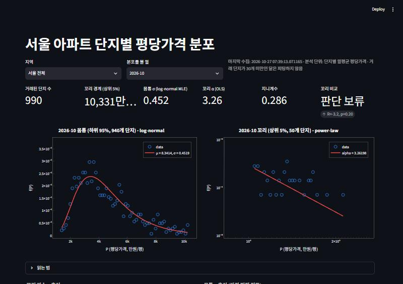
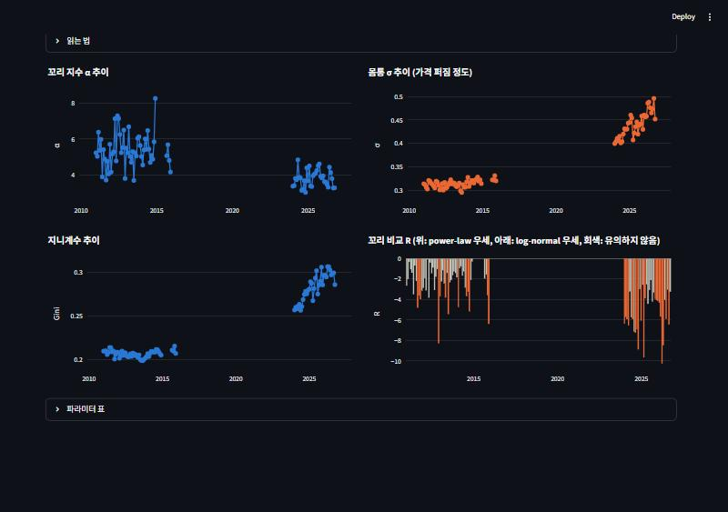
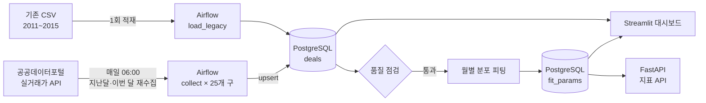

# 서울 아파트 가격은 어디서부터 '다른 세상'이 되는가

[](https://github.com/Jeongyeonjin/apt-apt/actions/workflows/tests.yml)

공공데이터포털 실거래가 API를 **Airflow로 매일 자동 수집**하고, 서울 아파트 **단지별 평당가격 분포**를
몸통(log-normal)과 꼬리(power-law)로 나눠 월마다 피팅한 뒤 **Streamlit 대시보드**로 보여주는 파이프라인.

`Python` `Airflow 3` `PostgreSQL` `FastAPI` `Docker Compose` `Streamlit` `Plotly` `SciPy`



## 핵심 결과

| 연평균 (서울 전체) | 2011~2015 | 2024 | 2025 | 2026 (1~10월) |
|---|---|---|---|---|
| 몸통 σ (log-normal, 가격 퍼짐) | 0.314 | 0.416 | 0.438 | 0.471 |
| 지니계수 (단지 간 불평등) | 0.207 | 0.266 | 0.287 | 0.298 |
| 꼬리 α (OLS, 작을수록 꼬리가 두꺼움) | 5.38 | 3.67 | 4.00 | 3.67 |

- 단지 간 평당가격 격차는 2010년대 초반보다 뚜렷하게 커졌고, **2024년 이후에도 매년 계속 커지고 있다** (σ, 지니 모두 상승).
- 꼬리 α도 낮아져 초고가 단지 쪽 꼬리가 두꺼워진 경향이 보인다. 다만 한 달 꼬리 표본이 50개 안팎이라 월별 α의 흔들림이 크다(아래 [검증](#검증) 참고).
- 꼬리 비교 검정(power-law vs log-normal)은 대부분 log-normal 쪽이거나 유의하지 않았다. 서울 초고가 단지 꼬리는 순수한 power-law라고 단정하기 어렵다.



## 아키텍처



| DAG | 스케줄 | 역할 |
|---|---|---|
| `apt_collect_daily` | 매일 06:00 | 지난달·이번 달 25개 구 재수집 → 품질 점검 → 두 달 피팅 갱신 |
| `apt_backfill_monthly` | 월 단위 catchup | 2024-01 ~ 2026-08을 한 달씩 순서대로 수집·피팅 |
| `apt_load_legacy` | 수동 1회 | 기존 CSV 적재 → 월별 피팅 |
| `apt_refit_all` | 수동 | 피팅 방법을 바꿨을 때 전체 월 재계산 |

## API (FastAPI)

피팅 결과를 다른 서비스에서 가져다 쓸 수 있도록 REST API로 제공한다.

- http://localhost:8000 : 지역과 월을 고르면 이 API를 불러 분포 곡선, 지표, 월별 추이를 보여주는 조회 화면
- http://localhost:8000/docs : 엔드포인트를 바로 호출해볼 수 있는 API 문서 (응답 필드마다 한글 설명)

| 엔드포인트 | 설명 |
|---|---|
| `GET /fit/{region}/{ym}` | 지역·월별 지표 (`region`: `서울` 또는 구 이름, `ym`: `2026-10`) |
| `GET /trend/{region}?start=YYYY-MM&end=YYYY-MM` | 월별 지표 추이 |
| `GET /months/{region}` | 조회 가능한 월 목록 |
| `GET /complexes/{region}/{ym}` | 피팅에 쓴 원자료 (단지별 평균 평당가격, 거래 건수) |
| `GET /latest` | 서울 전체 최신 월 지표 |
| `GET /regions` | 지역 목록 |
| `GET /health` | 서버 상태 |

```json
GET /fit/서울/2026-10
{"ym": "2026-10", "region": "서울 전체", "n": 1076, "median_price": 4236, "tail_start": 10435.33,
 "sigma": 0.4583, "gini": 0.288, "alpha": 3.3341, ...}
```
조회 로직은 `src/apt_pipeline/service.py`에 두고 API는 얇게 감싸기만 해서, FastAPI 없이도 테스트한다.
조회 화면은 API가 돌려준 μ, σ, α, 상위 5% 경계로 곡선을 다시 그리고, 가격에 마우스를 올리면 그보다 비싼 단지 비율을 계산해 보여준다.

## 데이터

- 대상: 서울 25개 자치구 아파트 매매 실거래
- 기간: 2011-01~2014-12, 2015-09~12 (기존 수집 CSV), 2024-01~현재 (API)
  - 기존 CSV 중 2015-01~08, 2016~2019는 저장 형식이 달라 제외했다
- **분석 단위: 단지별 월평균 평당가격**(만원/평). 평당가격 = 거래금액 ÷ (전용면적 ÷ 3.305785)

## 설계 포인트

**1. 신고 지연·계약 해제를 반영하는 재수집 + upsert**
실거래가는 계약 후 30일 안에 신고되고, 나중에 해제되기도 한다. 그래서 '어제 거래'만 받지 않고
매일 **지난달·이번 달을 통째로 다시 받아** 있으면 갱신, 없으면 추가한다. API에 거래 고유번호가 없어
거래를 식별하는 값들을 해시해 키로 쓰고, 조건이 같은 거래가 여러 건이면 순번을 붙여 모두 보존한다.
해제된 거래는 분석에서 뺀다.

**2. 분석 단위를 거래에서 단지로**
한 단지에서 같은 평형 264건이 같은 가격으로 한꺼번에 거래된 일괄 매각이 분포에 뾰족한 봉우리를 만드는 것을
발견했다. 거래 하나하나가 아니라 **단지별 월평균**을 점 하나로 써서, 거래 건수가 아닌 단지 간 가격 분포를 보도록 했다.

**3. Airflow 활용**
- Dynamic Task Mapping으로 25개 구 × 2개월 = 50개 수집 태스크를 자동 생성하고, 동시 API 호출 수를 제한
- 지수 백오프 재시도, 품질 점검(거래 0건, 평당가격 범위 이탈) 실패 시 피팅 중단
- `catchup=True` + `max_active_runs=1`로 32개월을 한 달씩 순서대로 백필
- 로직은 `src/apt_pipeline`에, DAG는 실행 순서만 정의 → Airflow 없이 테스트 가능

**4. 기존 수집 코드의 문제 수정**
예전 코드는 응답 필드 개수로 칸을 맞춰 값이 옆 칸으로 밀리거나 조용히 버려졌고, 1페이지(999건)만 받아 거래가
많은 달이 잘렸다. 태그 이름으로 파싱하고 `totalCount`를 보고 끝까지 페이지를 넘기도록 바꿨다.

## 분석 방법

매월 단지 평균 평당가격을 **95번째 백분위수**에서 나눠 따로 맞춘다.

- **몸통 (하위 95%)**: log-normal. 위쪽이 잘린 분포이므로 **잘린 log-normal을 최대우도(MLE)**로 추정 → μ, σ
- **꼬리 (상위 5%)**: power-law. 기존 연구 코드와 같은 방식으로, 꼬리만으로 **같은 폭 60구간 히스토그램**을
  만들고 구간 가운데 밀도에 `c·P^(−α)`를 **최소제곱(curve_fit)**으로 맞춘다 → α. 상위 0.05% 극단값은 제외
- 같은 꼬리에 **MLE α**도 함께 저장하고, 꼬리에서 power-law vs 잘린 log-normal **로그우도비 검정**(Vuong) → R, p
- 전체 단지의 **지니계수**

## 검증

**OLS α의 정확도** — 정답 α를 아는 power-law 표본으로 비교 ([analysis/bias_simulation.py](analysis/bias_simulation.py), 300회 반복)

| 실제 α | 꼬리 표본 | OLS 평균 (표준편차) | MLE 평균 (표준편차) |
|---|---|---|---|
| 2.5 | 50 | 2.86 (0.75) | 2.51 (0.21) |
| 3.0 | 50 | 3.38 (1.45) | 3.04 (0.32) |
| 4.0 | 50 | 4.57 (1.72) | 4.08 (0.42) |
| 2.5 | 250 | 2.77 (0.36) | 2.51 (0.09) |
| 3.0 | 250 | 3.12 (0.31) | 3.01 (0.12) |
| 4.0 | 250 | 4.08 (0.41) | 3.99 (0.18) |

서울 한 달 꼬리 수준(50개)에서는 히스토그램 OLS의 흔들림이 MLE보다 4~5배 크다. 그래서 α는 한 달 값보다
**연평균·추이로 해석**하고, MLE α를 함께 저장해 비교한다.

**꼬리 끝을 잘라야 할까** — 2026-10 꼬리에서 상위 1%를 피팅에서 빼보니 α가 약 3.3에서 2.4로 크게 바뀌었다.
꼬리 단지 대부분은 좁은 가격대에 고르게 퍼져 있고, "비쌀수록 드물다"는 기울기 정보는 끝쪽 드문 단지들이 준다.
끝부분은 노이즈가 아니라 정보라서 극단값 0.05%만 제외했다. 상위 1%를 포함하면 구간 수를 10~60개로 바꿔도
α가 약 3.3~3.4로 안정적이었다.

## 실행 방법

Docker Desktop 또는 WSL Ubuntu의 Docker Engine에서 실행한다.

1. [공공데이터포털](https://www.data.go.kr)에서 '국토교통부_아파트 매매 실거래가 상세 자료' 활용신청 → 일반 인증키 복사
2. `.env.example`을 `.env`로 복사하고 키 입력 (`.env`는 Git에 올라가지 않음)
3. (선택) 기존 CSV를 `legacy_data/`에 넣기
4. `docker compose up -d --build`
5. http://localhost:8080 (Airflow)에서 DAG 켜기 → http://localhost:8501 (대시보드), http://localhost:8000 (API 조회 화면)

API 연결만 먼저 확인하려면: `docker compose run --rm airflow python -m apt_pipeline.check_api`

## 테스트

```bash
pip install -r requirements-test.txt
PYTHONPATH=src python tests/test_pipeline.py      # 15개, 외부 연결 없이 SQLite + 가짜 API 응답
PYTHONPATH=src python analysis/bias_simulation.py # 위 검증 표 재현
```
API 응답 파싱, 해제·지연신고 upsert, 단지 평균 집계, 피팅 정확도, 기존 CSV 변환, 수집 → 점검 → 피팅 전체 흐름을
검증한다. push할 때마다 GitHub Actions에서 자동으로 실행된다.

## 폴더 구조

```
dags/                   Airflow DAG (실행 순서·스케줄만)
src/apt_pipeline/
  api.py                API 호출 · XML 파싱 · 페이지 처리
  records.py            레코드 정규화, 거래 키 생성
  db.py                 테이블 정의, upsert, 단지 평균 집계 (PostgreSQL/SQLite 공용)
  fitting.py            잘린 log-normal MLE, power-law OLS·MLE, 비교 검정, 지니
  jobs.py               수집 · 품질 점검 · 피팅 작업 단위
  service.py            API용 조회 함수
  legacy_loader.py      기존 CSV 변환 · 적재
  config.py             꼬리 비율, 구간 수 등 설정
dashboard/app.py        Streamlit 대시보드
api/main.py             FastAPI 지표 API
api/static/index.html   API 조회 화면
analysis/               검증용 시뮬레이션
tests/                  테스트
docs/                   README 이미지
```
